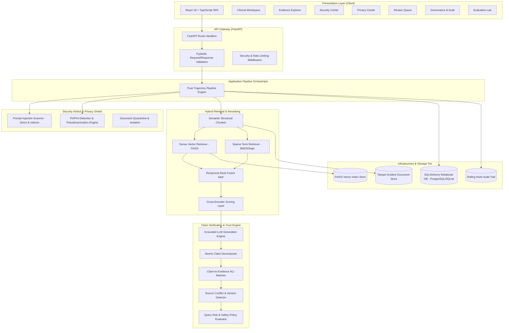

# MEDTRUST-ENGINE: System Architecture & Technical Design
**Document ID:** ARCH-MEDTRUST-2026-V1.0  
**Status:** Approved for Implementation  
**Classification:** Enterprise Clinical AI Architecture  
**Metaphor Layer:** Zero-G / Anti-Gravity Clinical Verification Framework

---

## 1. Architectural Philosophy & Zero-G Metaphor Layer

MedTrust-Engine structures clinical artificial intelligence through the **Zero-G Verification Metaphor**. In traditional AI, generated responses float without grounding, susceptible to epistemic drift and hallucination. MedTrust establishes gravitational anchors that bind claims to verified evidence.

```
+---------------------------------------------------------------------------------------+
|                                ZERO-G METAPHOR MAPPING                                |
+---------------------------+-----------------------------------+-----------------------+
| Zero-G Metaphor           | Clinical AI Technical Component   | Operational Function  |
+---------------------------+-----------------------------------+-----------------------+
| Evidence Gravity          | Hybrid Grounding Force            | Semantic attraction to|
|                           | (Dense + Sparse Retrieval)        | authorized guidelines |
| Evidence Anchors          | Provenance-Tracked Document Chunk | Page, section, hash   |
| Verification Orbit        | Claim NLI Verification Pipeline   | Decompose & test      |
| Epistemic Drift           | Hallucination / Unsupported Claim | Unanchored assertions |
| Security Airlock          | Adversarial & Injection Filter    | Isolate & quarantine  |
| Privacy Shield            | PII / PHI Redaction Engine        | Anonymize sensitive ID|
| Risk Field                | Contextual Query Risk Evaluator   | Dynamic safety policy |
| Review Dock               | Human-in-the-Loop Adjudication    | Clinician oversight   |
| Trust Trajectory          | End-to-End Observability Trace    | Step-by-step lineage  |
| Knowledge Orbit           | Indexed Document Corpus           | Versioned repository  |
+---------------------------+-----------------------------------+-----------------------+
```

---

## 2. High-Level System Architecture

The system follows a strict **5-Tier Clean Architecture**:

```
[ Presentation Layer: React 18 + TypeScript + Vite + Tailwind CSS + Lucide + Recharts ]
                                        │ (REST / JSON)
                                        ▼
[ API Layer: FastAPI Router + Pydantic v2 Schemas + OpenAPI Spec + CORS Middleware ]
                                        │
                                        ▼
[ Application Service Layer: Orchestration, Pipeline State Machine, Event Dispatcher ]
                                        │
                                        ▼
[ Domain Logic Layer: Security Airlock, Privacy Shield, Hybrid Retrieval, Claim Verifier, Risk Engine ]
                                        │
                                        ▼
[ Infrastructure Layer: SQLAlchemy ORM (PostgreSQL/SQLite), FAISS Vector Index, BM25 Index, LLM Provider ]
```



---

## 3. Technology Stack Decisions

```
+---------------------------------------------------------------------------------------+
|                                    TECHNOLOGY STACK                                   |
+-------------------+-------------------------------+-----------------------------------+
| Layer             | Technology Selection          | Rationale & Benefit               |
+-------------------+-------------------------------+-----------------------------------+
| Frontend SPA      | React 18, TypeScript (strict) | Robust type safety, reactive state|
| Build System      | Vite 5                        | Sub-second HMR, optimized bundles |
| Styling & Theme   | Tailwind CSS + Lucide Icons   | Bespoke clinical dark/light theme |
| State & Cache     | TanStack Query v5 + Context   | Query caching, optimistic updates |
| Visualizations    | Recharts                      | Trust profiles, telemetry charts  |
| Validation        | Zod (client) + Pydantic (API) | End-to-end schema synchronization |
| Backend API       | Python 3.11+, FastAPI         | Async high performance, OpenAPI   |
| Database ORM      | SQLAlchemy 2.0 (Async)        | Robust relational ORM             |
| DB Engine         | SQLite (Local) / PostgreSQL   | Zero-conf local dev + production  |
| Vector Index      | FAISS (CPU/GPU-ready)         | High-speed dense similarity search|
| Embeddings        | Sentence-Transformers         | Local offline semantic vectors    |
| Sparse Index      | BM25Okapi                     | Term-frequency exact keyword match|
| Document Parsing  | PyMuPDF (fitz)                | Fast, structured PDF text & layout|
| Test Runner       | Pytest + Vitest               | Comprehensive unit & e2e coverage |
+-------------------+-------------------------------+-----------------------------------+
```
