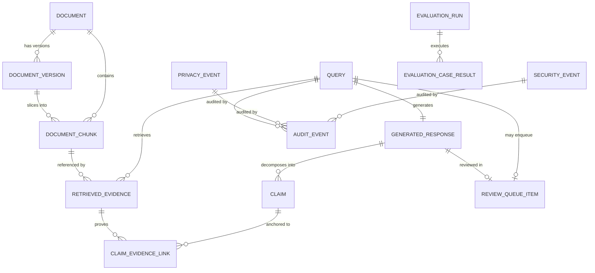

# MEDTRUST-ENGINE: Data Model & Schema Specification
**Document ID:** DATA-MEDTRUST-2026-V1.0  
**Status:** Approved for Implementation  
**Classification:** Database Architecture & Entity Specifications  
**Persistence Tier:** PostgreSQL 16+ / SQLite 3.40+ (SQLAlchemy Async Engine)

---

## 1. Entity-Relationship Overview

---

## 2. Relational Schema Definitions

### 2.1 `documents`
- `id` (VARCHAR PK): Unique identifier.
- `title` (VARCHAR): Clinical document title.
- `filename` (VARCHAR): Stored filename.
- `file_path` (TEXT): File system storage location.
- `file_size` (INTEGER): Size in bytes.
- `mime_type` (VARCHAR): `application/pdf`, `text/markdown`, `text/plain`.
- `content_hash` (VARCHAR UNIQUE): SHA-256 integrity hash.
- `domain` (VARCHAR): Medical specialty/domain.
- `authoring_body` (VARCHAR): Issuing authority (e.g. WHO, Surviving Sepsis).
- `tier` (INTEGER): Authority rating (1=Guideline, 2=SOP, 3=Trial).
- `status` (VARCHAR): `ACTIVE`, `SUPERSEDED`, `QUARANTINED`, `FAILED`.
- `total_pages` (INTEGER): Extracted page count.
- `created_at`, `updated_at` (TIMESTAMP).

### 2.2 `document_versions`
- `id` (VARCHAR PK)
- `document_id` (FK -> `documents.id`)
- `version_tag` (VARCHAR): e.g. `2024.1`, `2026.0`.
- `publication_date` (DATE)
- `is_current` (BOOLEAN)
- `superseded_by_id` (FK -> `document_versions.id`, NULL)
- `changelog` (TEXT)

### 2.3 `document_chunks`
- `id` (VARCHAR PK)
- `document_id` (FK -> `documents.id`)
- `version_id` (FK -> `document_versions.id`)
- `chunk_index` (INTEGER)
- `page_number` (INTEGER)
- `section_heading` (VARCHAR)
- `text_content` (TEXT)
- `protected_text` (TEXT)
- `token_count` (INTEGER)
- `content_hash` (VARCHAR)
- `embedding_id` (INTEGER)

### 2.4 `queries`
- `id` (VARCHAR PK)
- `session_id` (VARCHAR)
- `raw_query_text` (TEXT)
- `protected_query_text` (TEXT)
- `query_risk_tier` (VARCHAR): `INFORMATIONAL`, `INTERPRETIVE`, `CLINICAL_RECOMMENDATION`, `DOSAGE_TREATMENT`, `PATIENT_SPECIFIC`.
- `pii_count` (INTEGER)
- `status` (VARCHAR): `COMPLETED`, `INSUFFICIENT_EVIDENCE`, `BLOCKED`, `REVIEW_REQUIRED`, `ERROR`.
- `total_latency_ms` (FLOAT)
- `created_at` (TIMESTAMP)

### 2.5 `retrieved_evidence`
- `id` (VARCHAR PK)
- `query_id` (FK -> `queries.id`)
- `chunk_id` (FK -> `document_chunks.id`)
- `dense_score` (FLOAT)
- `sparse_score` (FLOAT)
- `rrf_score` (FLOAT)
- `rerank_score` (FLOAT)
- `rank_position` (INTEGER)
- `is_selected` (BOOLEAN)

### 2.6 `generated_responses`
- `id` (VARCHAR PK)
- `query_id` (FK -> `queries.id`, UNIQUE)
- `model_provider` (VARCHAR)
- `model_name` (VARCHAR)
- `response_text` (TEXT)
- `evidence_coverage_pct` (FLOAT)
- `mean_grounding_score` (FLOAT)
- `retrieval_quality_score` (FLOAT)
- `uncertainty_score` (FLOAT)
- `prompt_tokens` (INTEGER)
- `completion_tokens` (INTEGER)
- `final_status` (VARCHAR)
- `created_at` (TIMESTAMP)

### 2.7 `claims` & `claim_evidence_links`
- `claims`: `id`, `response_id`, `claim_index`, `claim_text`, `status`, `grounding_score`, `contradiction_score`, `explanation`.
- `claim_evidence_links`: `id`, `claim_id`, `evidence_id`, `entailment_score`, `citation_page`, `citation_section`.

### 2.8 `review_queue_items`
- `id`, `query_id`, `response_id`, `priority`, `reason`, `status` (`PENDING`, `APPROVED`, `REJECTED`, `RE_EVALUATED`, `ESCALATED`), `assigned_reviewer`, `reviewer_decision`, `reviewer_notes`, `resolved_at`, `created_at`.

### 2.9 `security_events` & `privacy_events`
- `security_events`: `id`, `event_type`, `threat_level`, `source_type`, `source_id`, `detected_pattern`, `action_taken`, `created_at`.
- `privacy_events`: `id`, `source_type`, `source_id`, `entity_type`, `masked_snippet`, `redacted_token`, `created_at`.

### 2.10 `audit_events`
- `id`, `event_type`, `actor_id`, `query_id`, `document_id`, `payload_hash`, `prev_chain_hash`, `current_chain_hash`, `created_at`.

### 2.11 `evaluation_runs` & `evaluation_case_results`
- `evaluation_runs`: `id`, `run_name`, `total_cases`, `passed_cases`, `failed_cases`, `mean_evidence_coverage`, `injection_detection_rate`, `pii_recall`, `mean_latency_ms`, `created_at`.
- `evaluation_case_results`: `id`, `evaluation_run_id`, `case_id`, `case_category`, `query_text`, `expected_status`, `actual_status`, `passed`, `metrics_json`, `created_at`.
